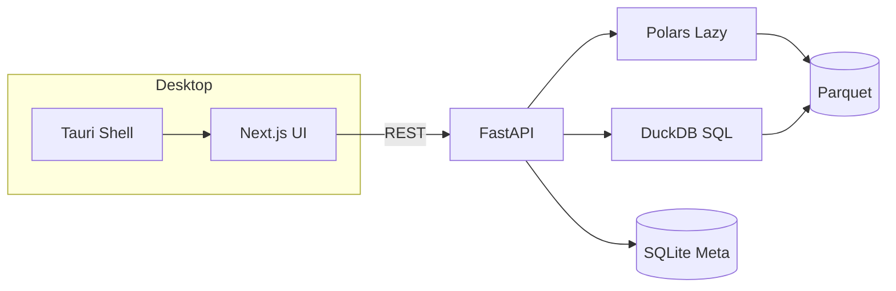

# DataForge Analytics — Platform Specification (v1.4)

Local-first, high-performance analytics desktop app — **Power BI / Tableau class UX**, 100% offline-capable.

**Repository:** `C:\Users\SEBAS\Projects\DataForgeAnalytics`

---

## 1. Massive Data Handling

| Requirement | Implementation |
|-------------|----------------|
| 50M+ rows, CSV/Parquet/JSON | `ImportService` + Polars lazy scan, chunked Parquet write |
| Virtual tables, server pagination | `GET /datasets/{id}/rows` — `QueryService` slice only |
| Fast aggregations / group-by | `POST /datasets/{id}/aggregate` — DuckDB over Parquet |
| Background import, retry/cancel | `import_background.py`, `worker_service.py`, job polling API |
| No full dataset in browser | All table/chart paths paginate or aggregate server-side |

---

## 2. Dashboard Builder

| Feature | Path |
|---------|------|
| 12-column drag grid | `dashboard-grid.tsx`, `react-grid-layout` |
| Widget types (KPI, bar, line, …) | `dashboard-editor.tsx` |
| Global filter bar + chips | `dashboard-filter-bar.tsx`, `dashboard-active-filters.tsx` |
| Variables + URL/localStorage | `dashboard-filter-context.tsx`, `dashboard-filters.ts` |
| Cross-widget click filter | `chart-renderer.tsx` → `applyCrossFilter` |
| Drill-through navigation | `dashboard_drillthrough_service.py`, `buildDrillthroughHref` |
| Widget filter bindings UI | `widget-config-drawer.tsx` |
| Templates (Executive, Sales, …) | `dashboard_template_service.py` |
| Presentation mode | `dashboard-editor.tsx` fullscreen |
| Demo dashboards (v1.3) | `demo_dashboards_v13.py` |

**Demo routes**

- Executive: `/dashboards/view?id=00000000-0000-4000-8000-000000000002`
- Regional: `…000003`
- Customer: `…000004`

---

## 3. Advanced Chart Engine

| Feature | Path |
|---------|------|
| Plugin registry | `frontend/src/lib/charts/registry.ts`, `backend/.../chart_engine/registry.py` |
| Sankey, funnel, candlestick, treemap, … | `chart-renderer.tsx`, `components/charts/advanced/` |
| PNG/SVG export | `chart-export.ts`, Chart Studio |
| Dashboard PDF | `GET /dashboards/{id}/export?format=pdf` |
| Click / drill handlers | `onDataPointClick` on `ChartRenderer` |
| Forecasting | `forecast_service.py`, `forecast_models.py` (linear, exp, Holt-Winters, ARIMA, Prophet) |

---

## 4. Backend

- **Stack:** Python 3.12, FastAPI, SQLAlchemy async, SQLite (default), optional PostgreSQL via `DATABASE_URL`
- **Analytics:** Polars + DuckDB on Parquet
- **API:** `backend/app/api/routes/` — datasets, dashboards, charts, workers, collaboration, forecasts
- **Not Node.js hybrid** — single Python API (simpler ops, one process for Tauri sidecar)

Collaboration: workspaces, members, roles, comments, `activity_log` — `collaboration.py`, `v12.py` models.

---

## 5. Workers & Async

- Local worker queue: import, profile, forecast jobs
- Progress, cancel, retry: `worker_service.py`
- UI: Settings → Background workers (CPU/memory stats polling)

---

## 6. UI / UX

| Feature | Location |
|---------|----------|
| Themes: dark, light, midnight, enterprise, cyberpunk | `providers.tsx`, `app-store.ts`, Settings |
| Command palette **Ctrl+K** | `command-palette.tsx` |
| **Ctrl+D** / **Ctrl+B** | `app-shell.tsx` shortcuts |
| Workspace tabs | `workspace-tabs.tsx` (app shell) |
| Onboarding | `onboarding-tour.tsx` |
| Filter bar + chips | Dashboard view |

---

## 7. AI & Insights

| Feature | Service |
|---------|---------|
| Natural language → SQL | `ai_analyst_service.py` |
| Auto insights | `insights_service.py` |
| Anomaly detection | `anomaly_service.py` |
| Profiling | `profiling_service.py` |
| Suggested charts | Chart templates + insights UI |

All run **locally** against Parquet — no cloud required.

---

## 8. Testing & Build

```powershell
# Backend
cd backend && .\.venv\Scripts\python -m pytest -q

# Frontend
cd frontend && npm run test && npm run build

# Desktop
cd frontend && npm run tauri:build
```

| Output | Path |
|--------|------|
| Windows `.exe` | `frontend/src-tauri/target/release/bundle/nsis/` |
| macOS `.dmg` | `frontend/src-tauri/target/release/bundle/dmg/` |

**Docker:** `docker compose up` — API + optional Postgres/Redis (see `docker-compose.yml`).

---

## 9. Security & Reliability

- API key / Bearer token on requests (`demo-token` dev default)
- Payload validation: Pydantic schemas, file validation on import
- Activity log for auditable actions
- Local-first data dir (`DATAFORGE_DATA_DIR`); optional dataset encryption — roadmap

---

## Architecture Diagram



---

## What is not in scope (v1.3)

- **Android native app** — use Tauri desktop + web; mobile would be a separate product
- **Real-time cloud sync** — local-first; URL sharing simulates collaboration
- **Full dockable IDE panels** — partial via app shell layout

For setup see [README.md](./README.md) and [BUILD.md](./BUILD.md).
